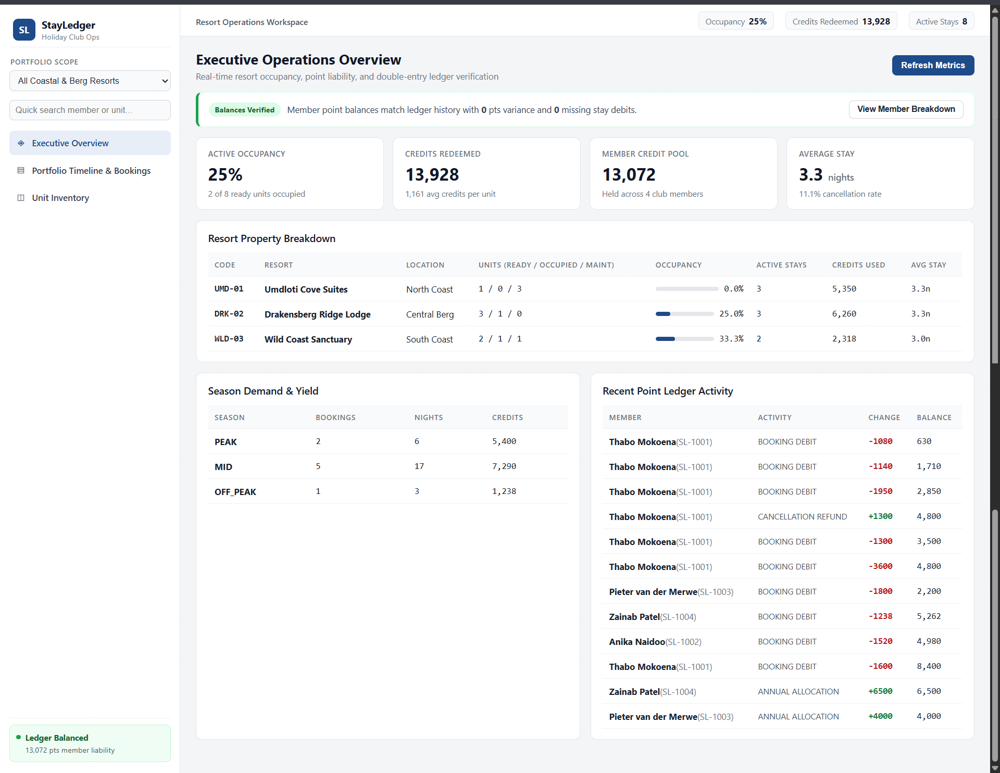
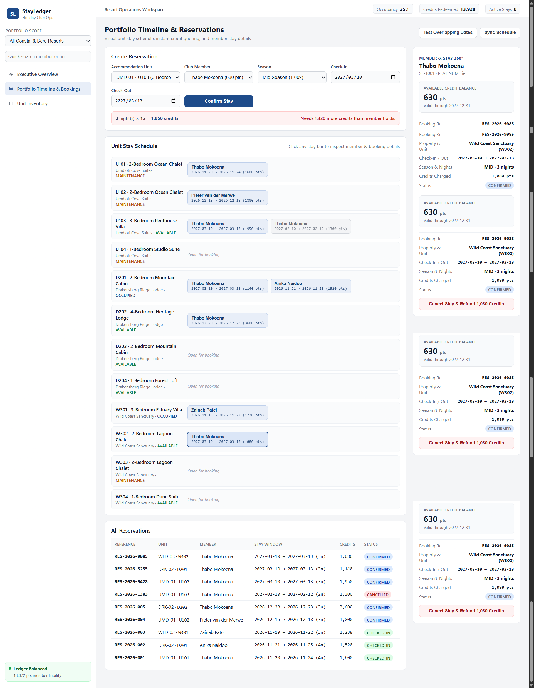
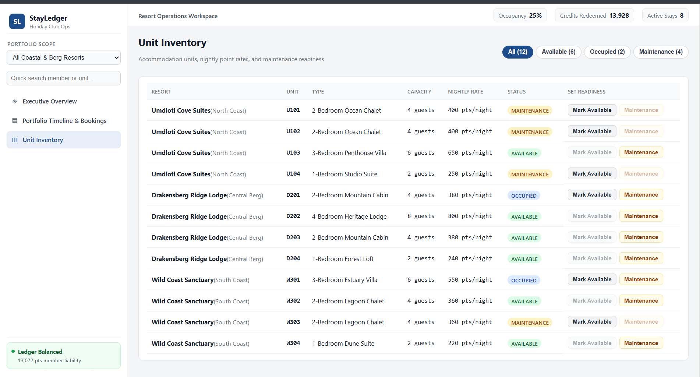

# StayLedger

**Multi-Property Holiday Club & Vacation Ownership Operations Console**

StayLedger is a full-stack points-based Property Management System (PMS) and double-entry credit ledger built for multi-resort holiday clubs. It pairs a zoneless **Angular** three-pane operations console with an **Express / TypeScript** API and **PostgreSQL** concurrency and financial integrity constraints.

---

## Interface & Operational Views

### 1. Executive Operations Overview
Provides resort executives and operations managers with a real-time financial and operational snapshot across all properties in a single database round-trip:

* **Persistent Navigation & Portfolio Rail:** Left sidebar featuring the **Portfolio Scope** resort selector (`All Coastal & Berg Resorts`, `Umdloti Cove Suites`, `Drakensberg Ridge Lodge`, `Wild Coast Sanctuary`), a global member/unit search bar, view navigation, and a live **Ledger Balanced** status indicator tracking total unredeemed credit liability.
* **Top-Strip Operational Counters:** Instant header pills displaying live **Occupancy %**, **Credits Redeemed**, and **Active Stays** across the console.
* **Double-Entry Ledger Verification Banner (`Balances Verified`):** Continuously audits every member's stored wallet balance against `SUM(credit_ledger.delta)` and checks for unposted reservation debits—reporting `0 pts variance` and `0 missing stay debits`, with an expandable **View Member Breakdown** audit proof table.
* **Executive KPI Cards:** Tracks **Active Occupancy** (excluding units in maintenance), **Credits Redeemed** alongside **PtPAU** (average credits redeemed per available unit), **Member Credit Pool** liability, and **Average Length of Stay (ALOS)** paired with the portfolio cancellation rate.
* **Resort Property Breakdown:** Compares property-level stock (`Ready / Occupied / Maint`), visual occupancy progress bars, active bookings, credits redeemed, and average stay duration.
* **Season Demand & Yield + Recent Point Ledger Activity:** Breaks down bookings, room nights, and credit yield across `PEAK` (1.50x), `MID` (1.00x), and `OFF_PEAK` (0.75x) bands alongside an immutable, chronological ledger feed (`BOOKING_DEBIT`, `CANCELLATION_REFUND`, `ANNUAL_ALLOCATION`).



---

### 2. Portfolio Timeline & 360° Stay Inspector
Combines reservation creation, seasonal point quoting, schedule visualization, and member account management in a two-column operations workspace:

* **Create Reservation & Live Credit Quote Engine:** Selecting an accommodation unit, club member, season band, and check-in/check-out dates dynamically calculates stay duration, seasonal multiplier, exact credit debit, and projected post-transaction balance—flagging invalid date ranges, insufficient credits, or maintenance locks before submission.
* **Overlap Conflict Verification (`Test Overlapping Dates`):** Pre-fills an active reservation's exact unit and date window so operators or reviewers can trigger and observe PostgreSQL's `btree_gist` exclusion lock (`409 Conflict`) translated into plain-English guidance.
* **Unit Stay Schedule:** Displays every accommodation unit across properties alongside interactive stay chips showing guest names, date windows, credit charges, and open booking slots.
* **All Reservations Ledger Table:** Searchable tabular view of reservation references (`SL-2026-...`), property/unit codes, stay windows, credit charges, and lifecycle statuses (`CONFIRMED`, `CHECKED_IN`, `CANCELLED`).
* **Right-Hand Member & Stay 360° Inspector:** Clicking any stay chip or reservation row opens the member's tier (`SILVER`, `GOLD`, `PLATINUM`), available credit balance, credit expiry date, full stay metadata, and a one-click **Cancel Stay & Refund Credits** action that atomically reverses the debit in `credit_ledger`.



---

### 3. Accommodation Unit Inventory
Centralizes physical room/villa stock control and maintenance readiness across all resorts:

* **Live Status Filter Chips:** Instant client-side filtering across **All**, **Available**, **Occupied**, and **Maintenance** units with real-time portfolio counts.
* **Unit Stock Directory:** Lists resort names, regions, unit codes (`UMD-01`, `DRK-02`, `WLD-03`), accommodation types (`Oceanfront Villa`, `Mountain Chalet`, `Coastal Suite`), guest sleep capacities, and base nightly credit rates.
* **Operational Readiness Toggles (`Mark Available` / `Maintenance`):** Allows operations staff to take units offline for refurbishment or return them to active booking inventory—immediately updating occupancy denominators and blocking new reservations on maintenance units.



---

## Core Architecture

* **Database-Level Concurrency Protection (`PostgreSQL btree_gist`):** Enforces exclusion constraints over `(unit_id WITH =, daterange(check_in, check_out, '[)') WITH &&)` on active reservations so overlapping bookings are atomically rejected (`409 Conflict`) at the storage layer.
* **Self-Reconciling Double-Entry Credit Ledger:** Every booking debit and cancellation refund executes inside an ACID transaction (`BEGIN ... COMMIT / ROLLBACK`), updating `members.credits_balance` and appending an immutable audit row to `credit_ledger`. Executive telemetry continuously verifies `credits_balance == SUM(delta)` across all members.
* **Single-Pass CTE Operational Telemetry:** Computes Active Occupancy %, Credits Redeemed per Available Unit (PtPAU), Unredeemed Member Credit Liability, Average Length of Stay (ALOS), and Season Yield (`OFF_PEAK` 0.75x, `MID` 1.00x, `PEAK` 1.50x) in a single PostgreSQL query.
* **Plain-English Operator Error Handling:** An Angular HTTP interceptor translates low-level database constraint violations and validation errors (`DATE_CONFLICT`, `INSUFFICIENT_CREDITS`, `UNIT_MAINTENANCE`) into clear, actionable guidance for resort staff.

---

## Tech Stack

* **Frontend:** Angular (Standalone Components, Signals, Zoneless Change Detection, Reactive Forms)
* **Backend:** Node.js, Express, TypeScript, `pg` connection pooling, Helmet, CORS
* **Database:** PostgreSQL 16 (`btree_gist` extension, transactional stored constraints, analytical CTE views)
* **Infrastructure:** Docker Compose

---

## Local Setup

### 1. Start PostgreSQL & Seed Schema
```bash
docker compose up -d
```

### 2. Run the Backend API (`http://localhost:4000/api`)
```bash
cd backend
cp .env.example .env
npm install
npm run dev
```

### 3. Run the Angular Operations Console (`http://localhost:4200`)
```bash
cd frontend
npm install
npm start
```

---

## Key API Endpoints

| Method | Endpoint | Purpose |
| :--- | :--- | :--- |
| `GET` | `/api/analytics/overview` | Portfolio KPIs, property breakdown, season yield & ledger reconciliation proof |
| `GET` | `/api/units` | List accommodation units with optional `propertyId` and `status` filters |
| `PATCH` | `/api/units/:id/status` | Transition unit readiness (`AVAILABLE`, `OCCUPIED`, `MAINTENANCE`) |
| `GET` | `/api/members` | Retrieve club members, tiers, and current credit balances |
| `GET` | `/api/reservations` | List reservations joined with property, unit, member, and season metadata |
| `POST` | `/api/reservations` | Atomically validate dates/credits, debit wallet, post ledger entry & lock unit dates |
| `PATCH` | `/api/reservations/:id/cancel` | Cancel reservation and atomically post a full credit refund entry |
